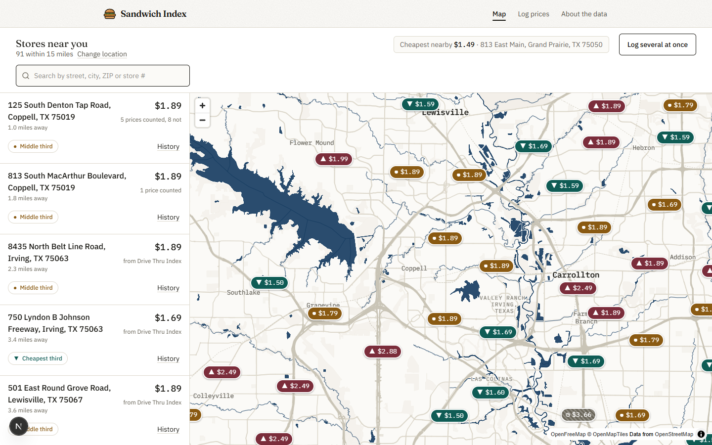
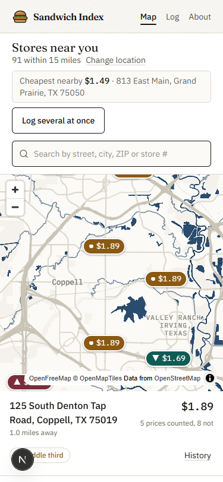
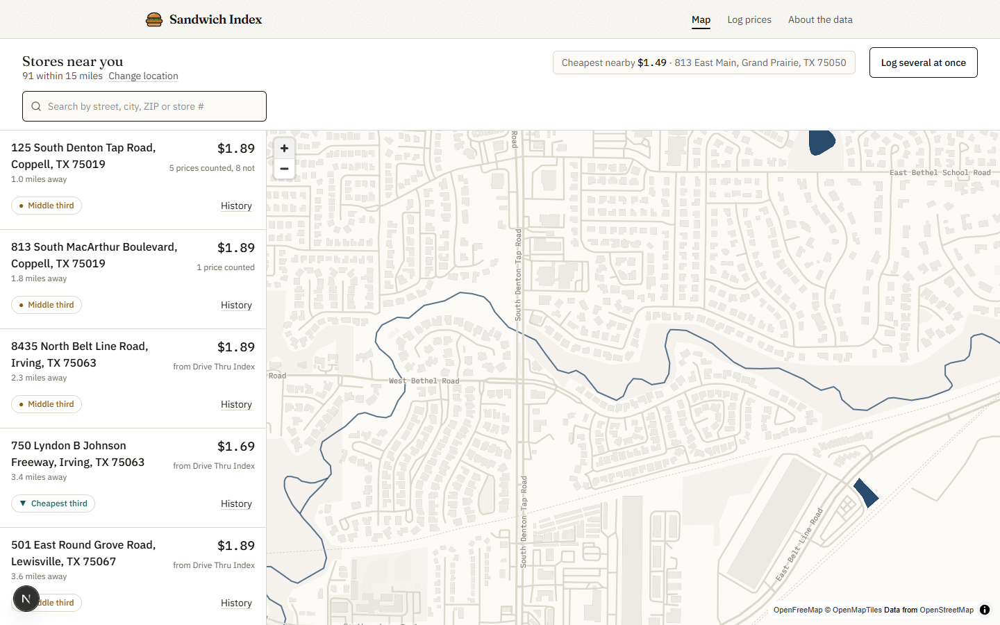
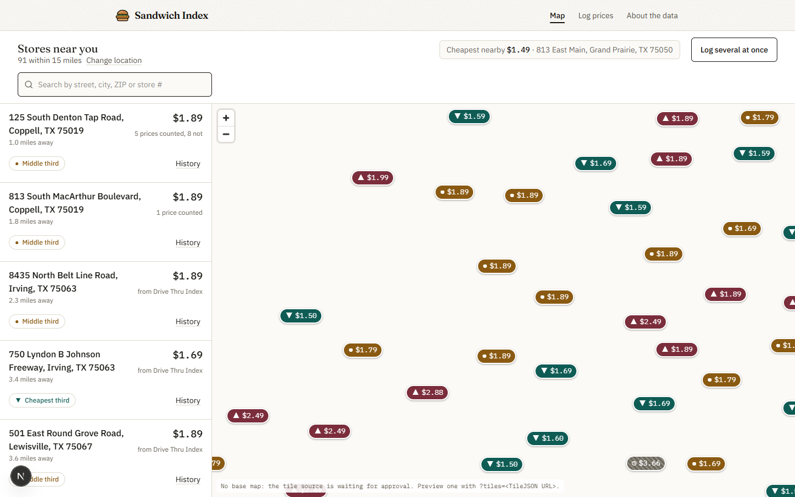

# Proposal: a tile source for the vector map (Phase H)

**Approved 2026-11-24: OpenFreeMap.** Wired in on `doc-remaining`: `VECTOR_TILES` is set, the host is
in `connect-src`, and every visitor gets the vector map. Step 3 below runs after the deploy; step 4
is still for later.

## What's built

The map page can draw a MapLibre GL vector map in the site's paper and ink in place of the Leaflet
one. Paper land, a fold darker for parks, accent navy water, quiet hairline roads, and ink labels in
IBM Plex Mono. The tier colours appear only on the price pills.

| File | What it does |
|---|---|
| `src/components/map/VectorMapCanvas.tsx` | The map: pills as HTML buttons, the drop-in, panning to a selection, framing search results |
| `src/lib/map-style.ts` | The style (OpenMapTiles layers), the colours, and `VECTOR_TILES`, the flag |
| `src/lib/pill-layout.ts` | Which pills to show when they would overlap |
| `src/components/map/pill.ts` | The pill's markup, shared with the Leaflet map |
| `src/lib/map-choice.ts` | Which map the page draws |
| `public/map/glyphs/` | The label font, built from the site's own Plex Mono by `scripts/build-map-glyphs.mjs` |

**The flag.** `VECTOR_TILES` (`src/lib/map-style.ts` line 33) is `null`, so visitors get the
Leaflet map exactly as before. In development only:

- `/map?map=vector` previews the vector map with no base map: the paper ground, the pills and the
  list.
- `/map?map=vector&tiles=https://tiles.openfreemap.org/planet` previews it against a host without
  committing to it.

A production build ignores both.

What it keeps from the Leaflet map: the same pills, the drop-in (once per map, nearest first, 35ms
apart, at most ten steps), the skeleton rows, the morph into the store page, and reduced motion
(no drop-in, no easing on pans, labels appear without fading).

What it adds: pills never overlap. When two would, the cheaper one stays (the selected store
always stays) and the other is hidden and taken out of the tab order. Every store is still a row in
the list beside the map. That clears the one accepted axe finding on the map page today,
target size where pins overlap in a dense area.

## Screenshots

Previewed in development against OpenFreeMap, Coppell, Nov 24:

| | |
|---|---|
|  |  |
|  |  |

The last one is what the page draws with no tile source, and also what it falls back to when the
host is down. Checked with an unreachable host: the paper ground, all 91 pills and the list still
draw. MapLibre logs a failed fetch to the console.

## Recommended: OpenFreeMap

Checked on openfreemap.org on Nov 24:

- **Free, no API key, no registration, and no limit on map views or requests.**
- **The OpenMapTiles schema**, which the style is written for. No layer needs rewriting.
- **Run by one person (Zsolt Ero) and funded by donations.** There's no SLA.
- **Open source (MIT).** If the public instance went away, the same tiles could be self-hosted.
  That would be a hosting decision for later.

| | URL |
|---|---|
| TileJSON (what `VECTOR_TILES` points at) | `https://tiles.openfreemap.org/planet` |
| Tiles | Listed in the TileJSON, on the same host |
| Fonts | Not used. Labels use the site's own glyphs from `/map/glyphs` |

**Attribution.** MapLibre's attribution control shows "OpenFreeMap © OpenMapTiles Data from
OpenStreetMap", read from the TileJSON. It sits bottom right, compact on a phone.

## Alternatives

| Host | Key | Limits | Schema | Notes |
|---|---|---|---|---|
| **OpenFreeMap** (recommended) | None | None stated | OpenMapTiles | Donation-funded, no SLA |
| VersaTiles (`tiles.versatiles.org`) | None | Per-IP rate limit (HTTP 429) | Shortbread | The style's layers would need rewriting for Shortbread. No uptime guarantee |
| Protomaps hosted API | Required | Free for non-commercial use only | Protomaps | Self-hosting a PMTiles file instead means paying for storage and bandwidth somewhere |
| Today: OpenStreetMap raster (`tile.openstreetmap.org`) | None | OSM's tile usage policy is for light use | Raster | What Leaflet draws now. Not paper and ink, and no SLA either |

## What wiring it in needs

Steps 1 and 2 are done (2026-11-24). Step 3 runs after the deploy; step 4 is for later.

1. **Set the source.** In `src/lib/map-style.ts` line 33, change it to
   `export const VECTOR_TILES = { url: "https://tiles.openfreemap.org/planet" };`.
2. **Allow the host in the CSP.** In `next.config.ts` line 27, add `https://tiles.openfreemap.org`
   to `connect-src`.
   - The page fetches the TileJSON, and the map's worker fetches the tiles. Both are connections,
     not images.
   - The worker script itself is same-origin, so `worker-src 'self' blob:` already covers it.
   - This is a deploy-config change, so it needs the OK.
3. **Deploy and check production.** Run `tests/browser/vector-map.js` against the live URL. Then
   look at the map at 375 and 1440 with real tiles. A local production build has run the vector
   map with no tiles under the production CSP: canvas, 91 pills, 53 hidden for overlap, no CSP or
   worker errors.
4. **Later, a separate change once it has been live for a while:**
   - Remove `leaflet`, `react-leaflet`, `@types/leaflet` and `MapCanvas.tsx`.
   - Remove `https://tile.openstreetmap.org` from `img-src` (`next.config.ts` line 23).

## Sizes

**Package added:** `maplibre-gl` 6.19.0, BSD-3-Clause. 30.1 MB unpacked in `node_modules`. No
other dependencies were added.

Downloaded by a visitor only when the vector map is on, measured in the production build:

| What | Size | Gzipped |
|---|---|---|
| Map chunk | 1.07 MB | 295 KB |
| Its worker | 551 KB | 158 KB |
| Its stylesheet | 71 KB | |
| Label glyphs, the 0–255 range of each of the two weights | 83 KB and 85 KB | (protobuf) |

The Leaflet chunk it would replace is 155 KB (45 KB gzipped). That's the main cost. The vector map
is about 450 KB gzipped against 45 KB, loaded only on `/map`, after the page itself.

The six glyph files total 624 KB. The 256–511 ranges (203 KB each) load only for a label with
Latin Extended letters. The 8192–8447 ranges (25 KB each) hold punctuation like curly quotes and
dashes.

**Deployed but never downloaded:** Turbopack also copies MapLibre's other dist files into
`static/media`. These are the development builds (3.8 MB), the main module as a file of its own
(1.1 MB) and a second copy of the stylesheet (72 KB), about 5 MB in all. No page requests them.
The worker (551 KB) is the one file from there that's used.
